# Diagram gallery

Every diagram `plotwork generate` makes in this repository, on one page. Each picture is one SVG that holds a light and a dark version and shows the one your GitHub theme uses, so the file looks right on its own too. None is drawn by hand: each is made from the file it names, and the check fails a pull request when the two no longer match.

## TL;DR

| Question | Answer |
|---|---|
| How many are there? | 25: 24 `.diagram` files in this folder, and one in a fence of [architecture.md](architecture.md). |
| Why one SVG and not two? | `"scheme": "auto"` in the `defaults` of [plotwork.config.json](../plotwork.config.json). A plain `` or a link to the file then shows the reader's theme; with two files only a `<picture>` element could. |
| How do I change one? | In its overrides file, such as [infra.overrides.json](infra.overrides.json). Never in the `.diagram` file or the SVG, which the next run writes over. |
| What is it made from? | The file under each picture, read by the importer its `format` in the settings names. |

## Infrastructure

Cloud resources, each from the infrastructure code that makes them.

### Parcelpoint on Azure

The production environment of the Terraform stack: `envs/prod` and the four modules it calls. Made from [infra/terraform](../infra/terraform); diagram source in [infra.diagram](infra.diagram).

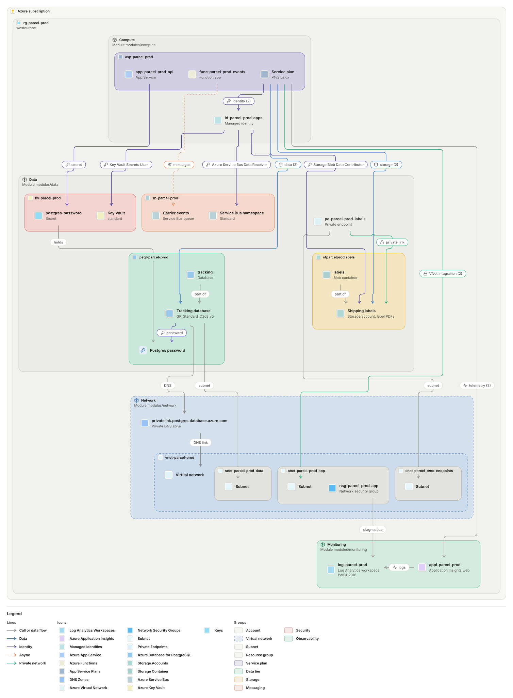

### Parcelpoint on Azure, development

The `dev` environment of the same Terraform stack. Made from [infra/terraform](../infra/terraform); diagram source in [infra-dev.diagram](infra-dev.diagram).

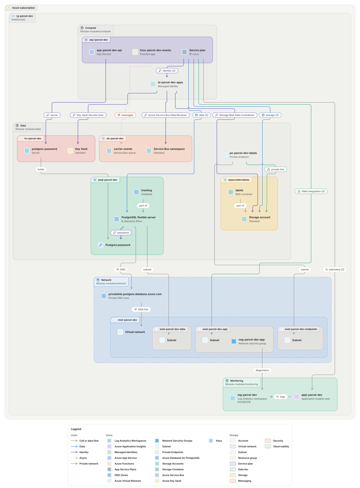

### Parcelpoint on Azure, from Bicep

The same Azure stack in Bicep, with the production parameters. Made from [infra/bicep](../infra/bicep); diagram source in [infra-bicep.diagram](infra-bicep.diagram).

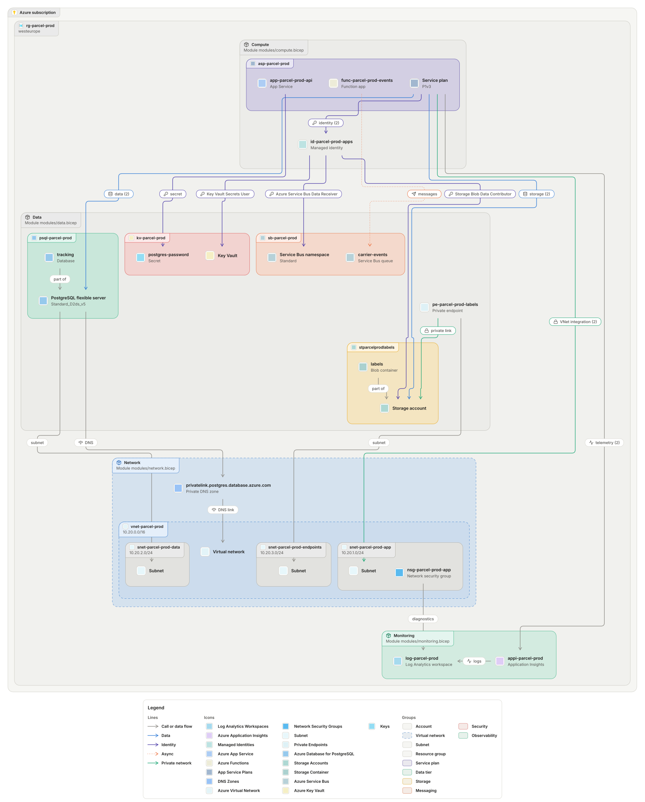

### Parcelpoint's label and event services, from an ARM template

The label and event services as an ARM template, with its parameters file. Made from [infra/arm](../infra/arm); diagram source in [infra-arm.diagram](infra-arm.diagram).

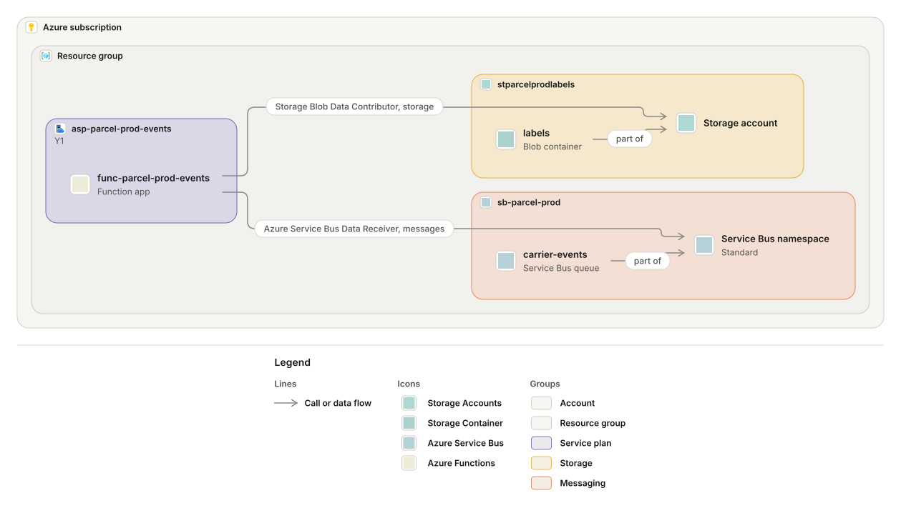

### Parcelpoint on Azure, from Pulumi

The Azure stack as a Pulumi program, with the settings of the `prod` stack. Made from [infra/pulumi/Pulumi.yaml](../infra/pulumi/Pulumi.yaml); diagram source in [infra-pulumi.diagram](infra-pulumi.diagram).

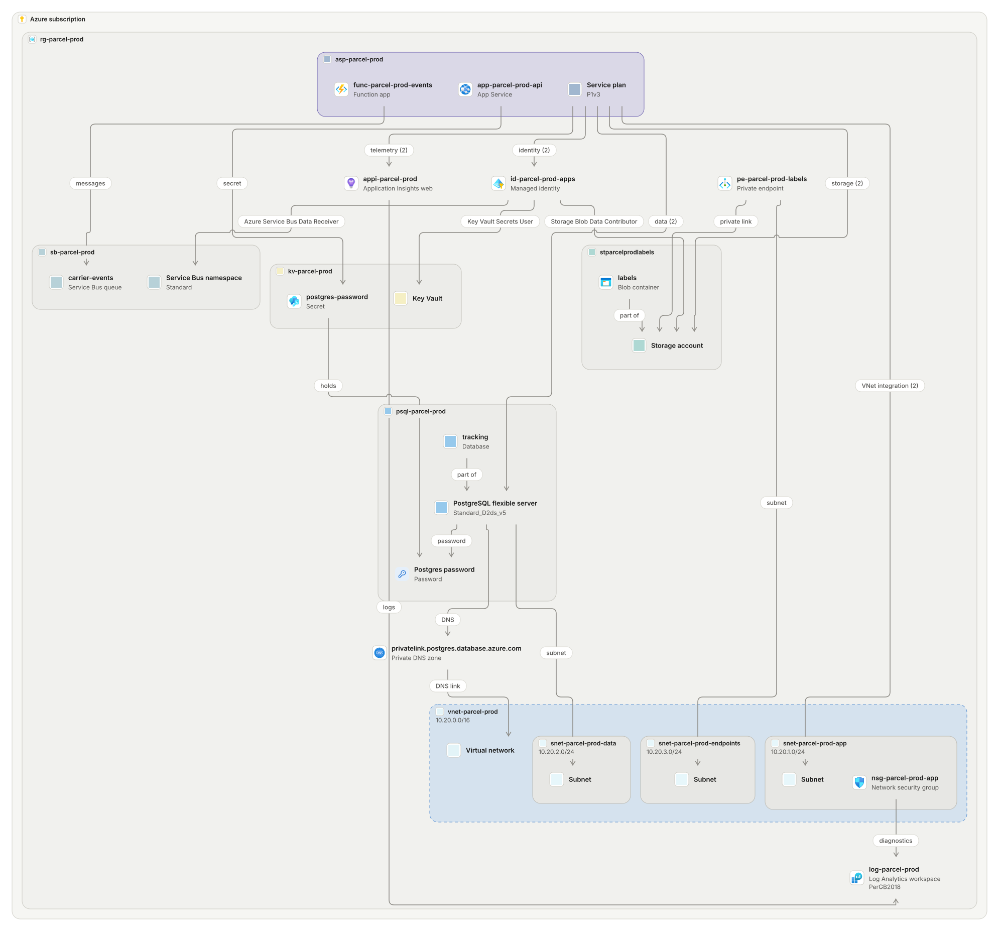

### Parcelpoint on Azure, from a Pulumi stack export

What a Pulumi stack export says is deployed. Made from [infra/pulumi/stack-export.json](../infra/pulumi/stack-export.json); diagram source in [infra-pulumi-state.diagram](infra-pulumi-state.diagram).

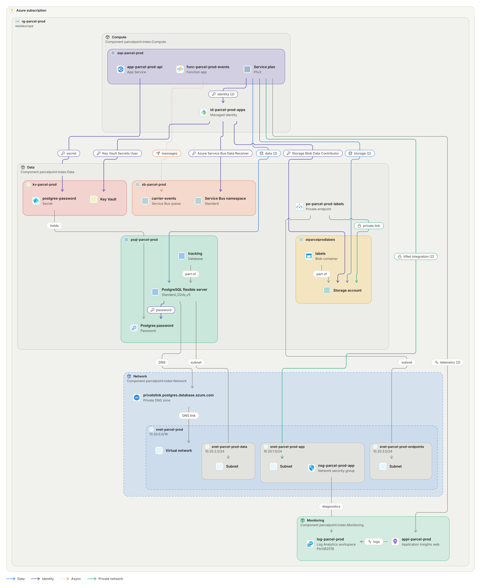

### Parcelpoint on AWS, from CloudFormation

The tracking API on AWS, from a SAM template. Made from [infra/cloudformation/template.yaml](../infra/cloudformation/template.yaml); diagram source in [infra-aws.diagram](infra-aws.diagram).

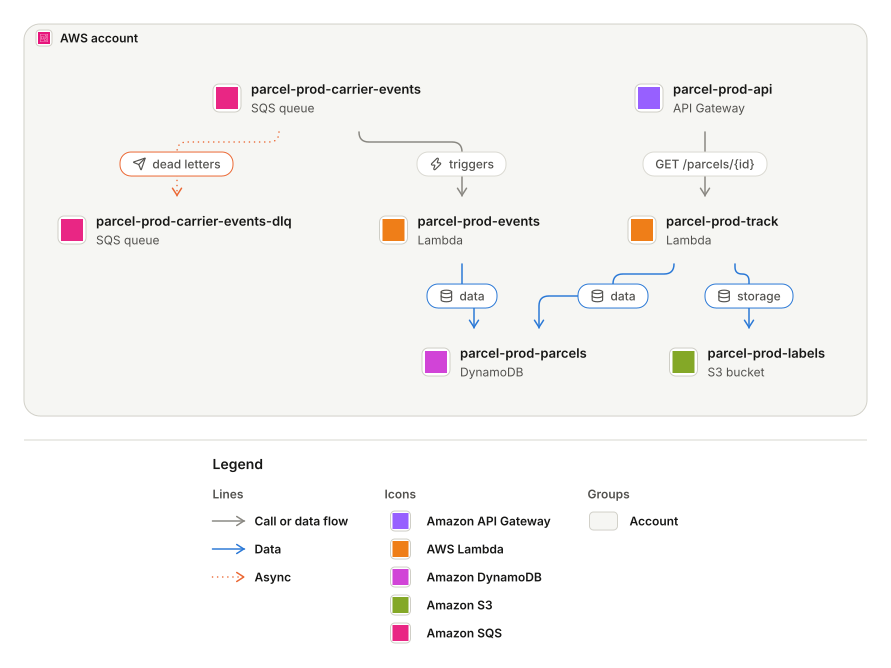

### Parcelpoint's label printing on AWS, from the CDK

The label printing service on AWS, from what `cdk synth` writes: two stacks and a nested stack of alerts. Made from [infra/cdk/cdk.out](../infra/cdk/cdk.out); diagram source in [infra-cdk.diagram](infra-cdk.diagram).

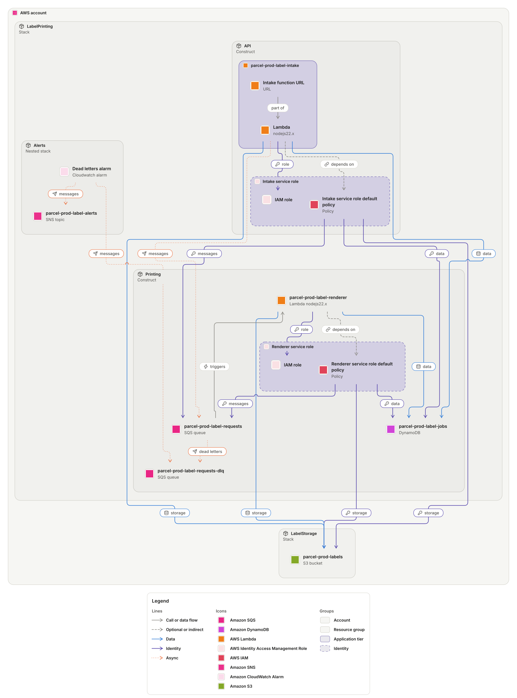

## Containers and deployment

How the services run, on a laptop and on Kubernetes.

### Parcelpoint services on a laptop

The Docker Compose stack a developer runs. It is generated into a fence of [architecture.md](architecture.md). Made from [compose.yaml](../compose.yaml); diagram source in [architecture.md](architecture.md#the-stack-on-a-laptop).

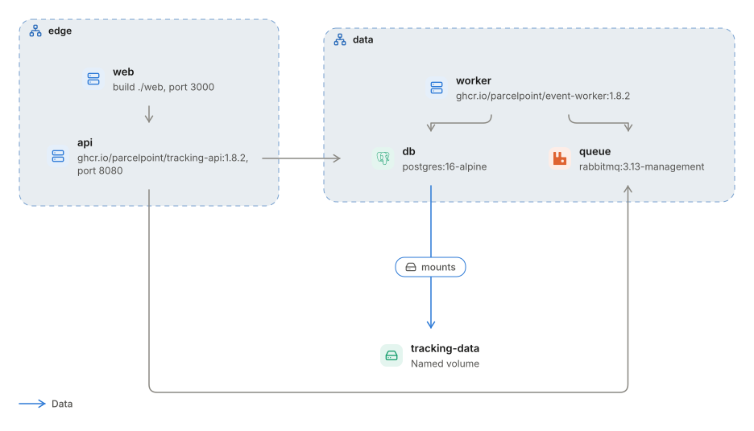

### Parcelpoint on Kubernetes

The same services as Kubernetes manifests. Made from [k8s](../k8s); diagram source in [cluster.diagram](cluster.diagram).

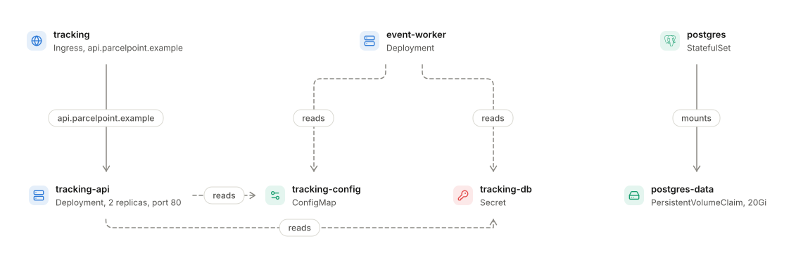

### The tracking chart and what it depends on

The tracking chart, its dependencies, and the versions `Chart.lock` resolved. Made from [deploy/helm/tracking](../deploy/helm/tracking); diagram source in [helm-chart.diagram](helm-chart.diagram).

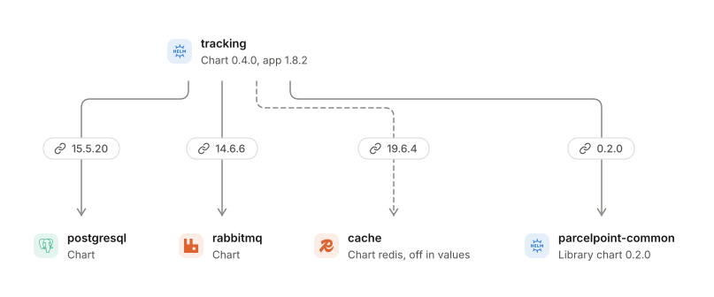

### The tracking release, from helm template

What `helm template` renders from that chart, framed by release and chart. Made from [deploy/helm/rendered/tracking.yaml](../deploy/helm/rendered/tracking.yaml); diagram source in [helm-release.diagram](helm-release.diagram).

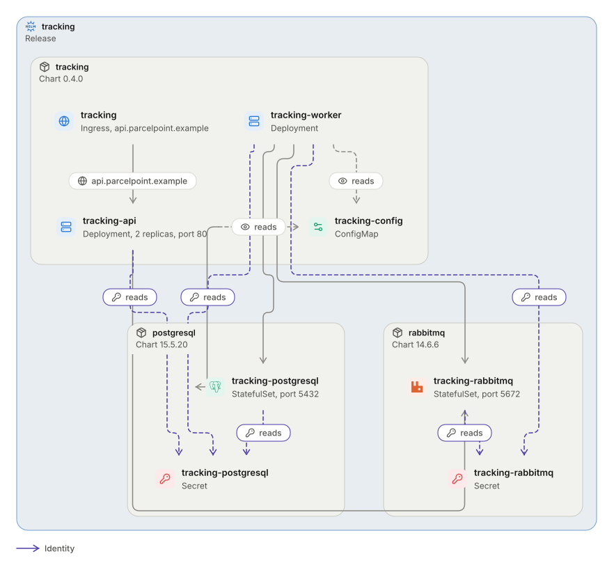

### The webhook sender's overlays, bases, and components

The webhook sender's base, its `dev` and `prod` overlays, and a tracing component. Made from [deploy/kustomize/webhook-sender](../deploy/kustomize/webhook-sender); diagram source in [kustomize.diagram](kustomize.diagram).

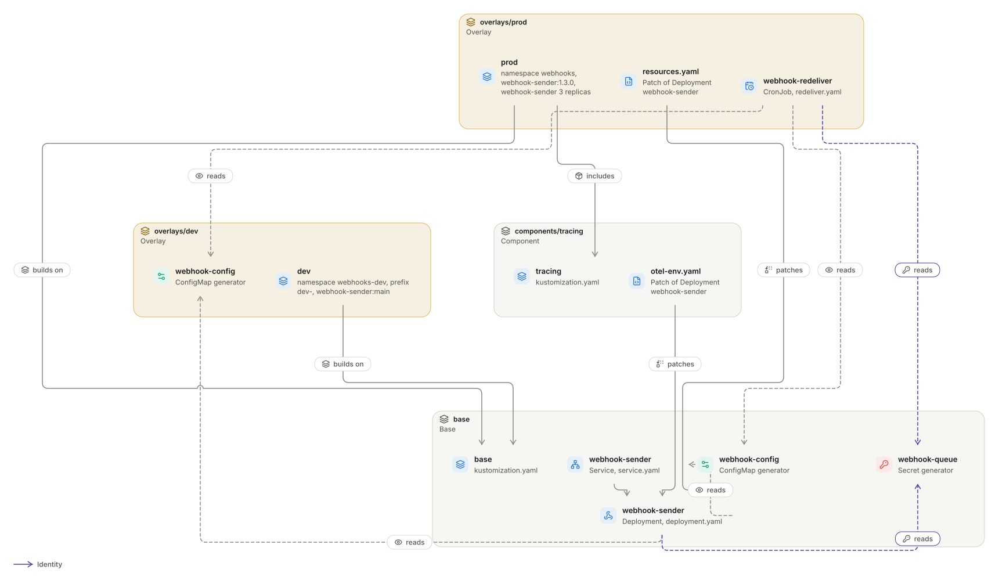

### The webhook sender in production, from kustomize build

What `kustomize build overlays/prod` writes. Made from [deploy/kustomize/built/webhook-sender-prod.yaml](../deploy/kustomize/built/webhook-sender-prod.yaml); diagram source in [kustomize-prod.diagram](kustomize-prod.diagram).

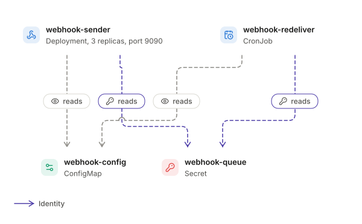

## APIs and events

What the services offer and the messages between them.

### Parcelpoint tracking API endpoints

The endpoints of the tracking API, by tag. Made from [api/openapi.json](../api/openapi.json); diagram source in [api.diagram](api.diagram).

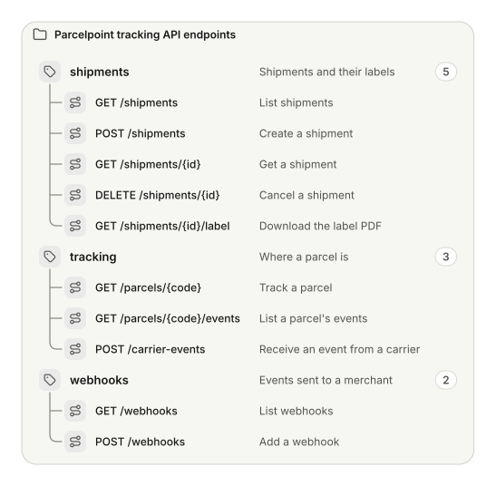

### Who may call each endpoint

Who may call each endpoint of the same API. Made from [api/openapi.json](../api/openapi.json); diagram source in [api-access.diagram](api-access.diagram).

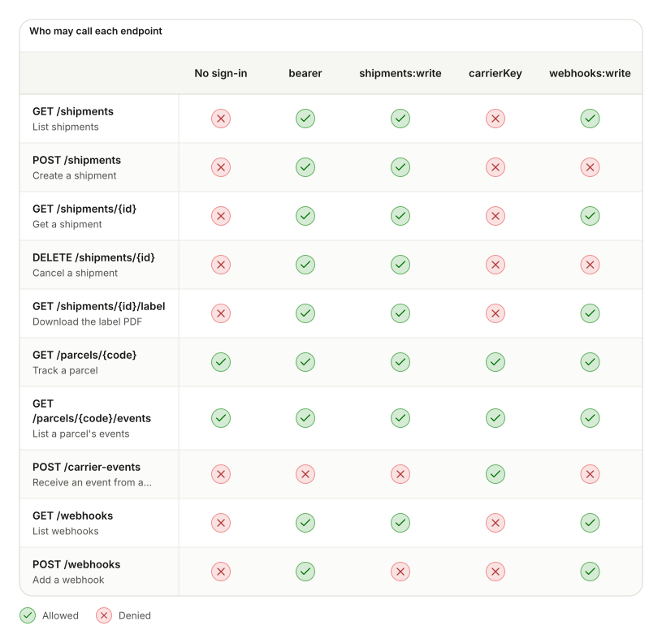

### Parcel events on RabbitMQ

The messages on RabbitMQ, from AsyncAPI 3 and AsyncAPI 2 documents that meet on shared channels. Made from [events](../events); diagram source in [events.diagram](events.diagram).

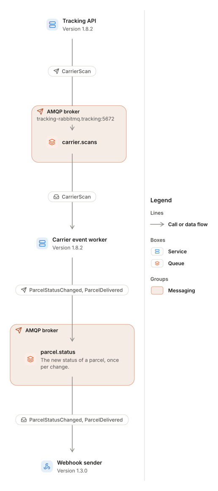

## Architecture and ownership

The software catalog and the C4 model.

### Parcelpoint's software catalog

The Backstage catalog by system: components, APIs, and resources. Made from [catalog](../catalog); diagram source in [catalog.diagram](catalog.diagram).

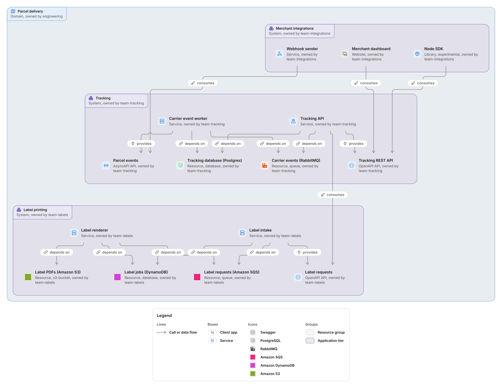

### Who owns what in Parcelpoint's catalog

The same catalog framed by the team that owns each entity. Made from [catalog](../catalog); diagram source in [catalog-teams.diagram](catalog-teams.diagram).

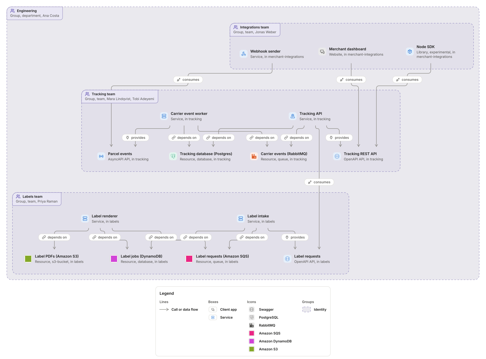

### Parcelpoint's containers

The container view of the Structurizr workspace. Made from [architecture/workspace.dsl](../architecture/workspace.dsl); diagram source in [c4-containers.diagram](c4-containers.diagram).

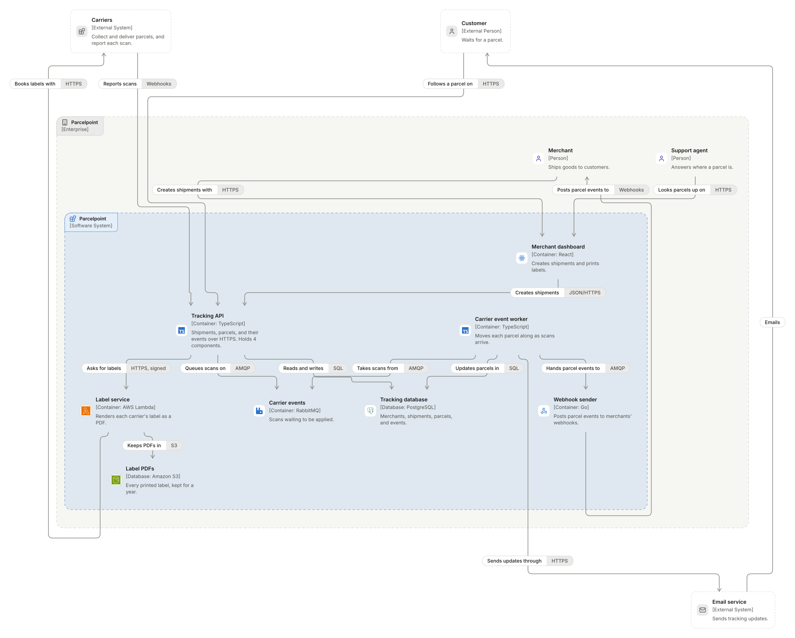

## Data

Where the data lives and what it says.

### Tracking database

The tables of the tracking database, from its SQL schema. Made from [db/schema.sql](../db/schema.sql); diagram source in [database.diagram](database.diagram).

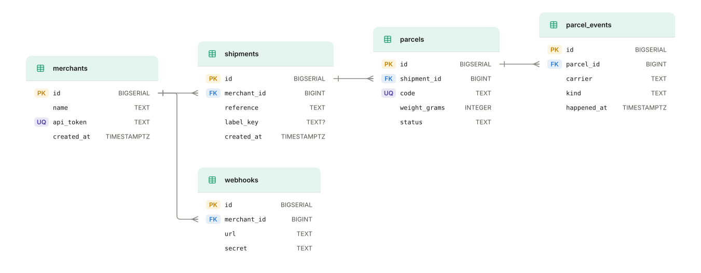

### Shipments by region

Monthly shipments by region, from a CSV file. Made from [data/shipments.csv](../data/shipments.csv); diagram source in [shipments.diagram](shipments.diagram).

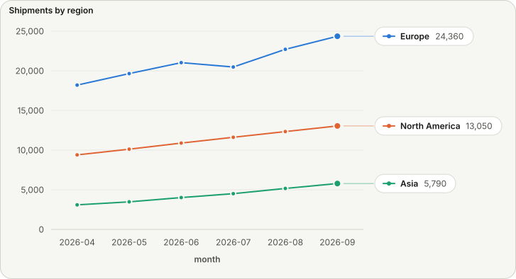

## Pipelines

The CI/CD pipelines, one for each system they run on.

### Pull request checks

The pull request check of this repository, from its GitHub Actions workflow. Made from [.github/workflows/check.yml](../.github/workflows/check.yml); diagram source in [ci.diagram](ci.diagram).

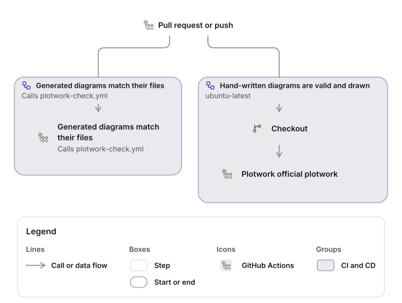

### The webhook sender's GitLab pipeline

The webhook sender's GitLab pipeline: `needs`, `rules`, a manual deploy, and two triggers. Made from [pipelines/gitlab/.gitlab-ci.yml](../pipelines/gitlab/.gitlab-ci.yml); diagram source in [ci-gitlab.diagram](ci-gitlab.diagram).

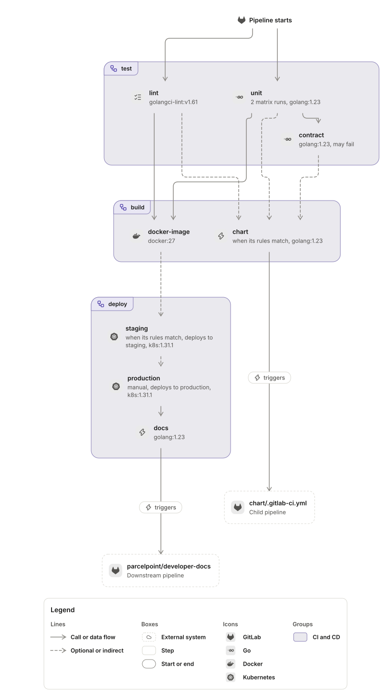

### The label service's Azure pipeline

The label service's Azure pipeline: stages, `dependsOn`, and deployment jobs. Made from [pipelines/azure/azure-pipelines.yml](../pipelines/azure/azure-pipelines.yml); diagram source in [ci-azure.diagram](ci-azure.diagram).

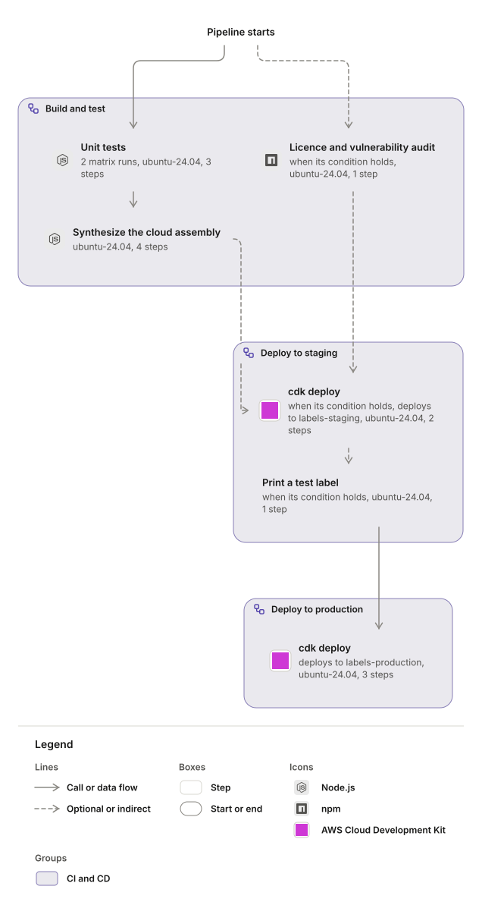

## See also

| Page | Why |
|---|---|
| [architecture.md](architecture.md) | The architecture page, with a diagram generated into a Markdown fence |
| [diagrams/](../diagrams/README.md) | Hand-written diagrams of other kinds |
| [Diagrams as code](https://docs.plotwork.dev/diagrams-as-code) | The guide to `sources`, overrides, `scheme`, and the workflows |
